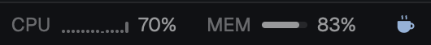

# Better Awake for Herdr

[中文](README.zh-CN.md)

A coffee cup for the [Herdr](https://herdr.dev) status bar that keeps your computer awake while your agents work, modeled on [Sheprd](https://sheprd.org)'s cup.



- **Click**: stay awake until you click again
- **Right-click**: stay awake until every agent finishes (a dot marks it)
- Keeps the display awake too; switch to system only to let it sleep and lock
- Lets go the moment Herdr quits or crashes
- macOS (`caffeinate`), Linux (`systemd-inhibit`), Windows (`SetThreadExecutionState`)

## Install for agent

Paste this to your agent in Herdr:

```text
Install the Herdr mod at https://github.com/Umupa/herdr-better-awake:
copy mods/better-awake into ~/.config/herdr-app/mods/, run herdr-app check on it,
and put its block at the right end of my layout's status bar (see its README).
```

## Install by hand

```sh
git clone https://github.com/Umupa/herdr-better-awake.git
cp -R herdr-better-awake/mods/better-awake ~/.config/herdr-app/mods/
```

Shipped layouts are read-only, so clone yours first (`herdr-app do layout.clone '{"name":"main","as":"my-layout"}'`). Then wrap the status block in a row and add the cup after it:

```json
{ "id": "status-row", "type": "row", "size": { "px": 28 }, "resizable": false, "children": [
  { "id": "status", "type": "block", "content": { "mod": "workspace-status" } },
  { "id": "better-awake", "type": "block", "size": { "px": 32 }, "content": { "mod": "better-awake" } }
] }
```

With [Better Status](https://github.com/Umupa/herdr-better-status), give the block `"props": { "headless": true }` and `"size": { "px": 1 }`: Better Status draws the cup left of your one thing.

## Commands

`herdr-app do better-awake.<command>`, or bind them in `keys.json`:

| Command | Does |
|---|---|
| `toggle` | What a click does |
| `agents` | What a right-click does |
| `on` / `off` | Stay awake until turned off / stop |
| `for-30m`, `for-2h`, `for-90s` | Stay awake for a while (up to a day) |
| `display` / `system` / `scope` | Keep the display awake too / only the system / switch; applies to the next hold |

## Notes

Runs `caffeinate` (macOS), `systemd-inhibit` (Linux) or `powershell.exe` with `hold.ps1` (Windows), and `ps` to find them again. No network. Linux and Windows are untested. Closing the lid still sleeps. Apache-2.0.
