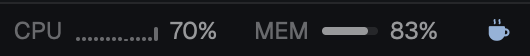

# Better Awake for Herdr

[English](README.md)

[Herdr](https://herdr.dev) 状态栏上的咖啡杯：agent 干活时让电脑不睡眠，仿照 [Sheprd](https://sheprd.org) 的杯子。



- **左键**：一直保持唤醒，再点一次关闭
- **右键**：保持到所有 agent 完成（杯子右下角有圆点）
- 默认连屏幕一起保持常亮；可切换为只防系统睡眠，让屏幕照常熄灭和锁屏
- Herdr 退出或崩溃时立刻释放
- macOS（`caffeinate`）、Linux（`systemd-inhibit`）、Windows（`SetThreadExecutionState`）

## 让 agent 安装

把这段发给 Herdr 里的 agent：

```text
安装 Herdr mod https://github.com/Umupa/herdr-better-awake：
把 mods/better-awake 复制到 ~/.config/herdr-app/mods/，用 herdr-app check 检查，
再按它的 README 把杯子放到我布局状态栏的最右边。
```

## 手动安装

```sh
git clone https://github.com/Umupa/herdr-better-awake.git
cp -R herdr-better-awake/mods/better-awake ~/.config/herdr-app/mods/
```

自带布局是只读的，先复制一份（`herdr-app do layout.clone '{"name":"main","as":"my-layout"}'`），再把状态栏那一块包进一个横排，后面加上杯子：

```json
{ "id": "status-row", "type": "row", "size": { "px": 28 }, "resizable": false, "children": [
  { "id": "status", "type": "block", "content": { "mod": "workspace-status" } },
  { "id": "better-awake", "type": "block", "size": { "px": 32 }, "content": { "mod": "better-awake" } }
] }
```

配合 [Better Status](https://github.com/Umupa/herdr-better-status) 使用时，给这一块加上 `"props": { "headless": true }`、`"size": { "px": 1 }`，杯子会由 Better Status 画在「你的一件事」左侧。

## 命令

`herdr-app do better-awake.<命令>`，也可以在 `keys.json` 里绑定快捷键：

| 命令 | 作用 |
|---|---|
| `toggle` | 同左键 |
| `agents` | 同右键 |
| `on` / `off` | 一直保持唤醒 / 关闭 |
| `for-30m`、`for-2h`、`for-90s` | 保持一段时间（最长一天） |
| `display` / `system` / `scope` | 连屏幕一起 / 只防系统睡眠 / 切换；下次开启时生效 |

## 说明

会运行 `caffeinate`（macOS）、`systemd-inhibit`（Linux）或 `powershell.exe` 加 `hold.ps1`（Windows），并用 `ps` 找回它们。不联网。Linux 和 Windows 尚未实测。合上笔记本盖子仍会睡眠。Apache-2.0。
