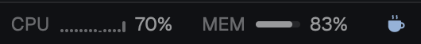

# Better Awake

A coffee cup in Herdr's status bar that keeps the computer awake: click for until-clicked-again, right-click for until every agent finishes. Modeled on Sheprd's status bar cup.

**What you see:**

- A 32px block at the right end of the status bar, `t.chrome` background, 1px `t.border` top border, the cup centered: a 13px cup in a 4px-rounded hit area (6px side padding, `t.hover` on hover).
- Off: an outlined cup (`icons/cup.svg`), `t.muted`. On: a filled cup with two wisps of steam (`icons/cup-full.svg`), `t.accent`. Changing: the outlined cup, `t.dim`.
- Held until agents finish: a 6px dot at the cup's bottom right (1px `t.chrome` ring, the cup's color).
- Tooltip: `Keep the display awake · Right-click: until agents finish` (off), `Keeping the display awake · Right-click: until agents finish` (on), `Keeping the display awake until agents finish`; "the system" in place of "the display" with the system scope.

**How it behaves:**

- Click: off → held until clicked again; on → off.
- Right-click: held until agents finish → off; no agent working → warning toast `No agent is working, so there is nothing to stay awake for.`; held until clicked → held until agents finish; off → held until agents finish.
- Until agents finish ends once no terminal (`terminals()`, so sub-agents count) reports `working`, checked each second; while a machine's layout is `loading` it waits.
- Scope `display` (default) keeps the display awake too; `system` lets it sleep and lock. A hold keeps the scope it started with.
- `for-<n>s|m|h` holds for that long (1 s to a day); any later change drops the timer.
- The hold is gone when Herdr quits or crashes. A mod reload keeps it. On a fresh start the cup is off.
- If the helper dies, the cup turns off and a warning toast says so within about 5 seconds. If it can't start, an error toast shows why.
- Commands (`better-awake.<c>`): `toggle`, `agents`, `on`, `off`, `for-30m`…, `display`, `system`, `scope`.

**Built from:**

- `mods/better-awake/` (`mod.json`: `{ "place": "none" }`), `main.js`, `hold.ps1`, `icons/cup.svg`, `icons/cup-full.svg` (drawn for this mod).
- Shared keys: `better-awake` = `{ cup: "off"|"pending"|"on", mode: "indefinite"|"agents", scope, app, pid, until }`, `better-awake.scope` = `"display"|"system"`.
- One copy owns the hold (a module-level `owner`): it answers `nextCommand()`, runs a 1 s `cx.timer.every`, and on start finds Herdr's pid (`sh -c 'echo $PPID'`; Windows: the `ParentProcessId` of a `powershell.exe`). A stored hold is kept only if its `app` matches and its `pid` is alive.
- Clicks call `run("better-awake.toggle")` / `run("better-awake.agents")`, so any copy, or another mod, can draw the cup.
- Helpers, started in the background, all tied to Herdr's pid so they end with it:
  - macOS: `caffeinate -i [-d] -w <herdr pid>`.
  - Linux: `systemd-inhibit --what=[idle:]sleep --who=Herdr --why='Better Awake' --mode=block sh -c 'while kill -0 <herdr pid>; do sleep 2; done'`.
  - Windows: `Start-Process powershell.exe -WindowStyle Hidden -PassThru` running `hold.ps1 -App <pid> [-Display]`: `SetThreadExecutionState(ES_CONTINUOUS | ES_SYSTEM_REQUIRED [| ES_DISPLAY_REQUIRED])`, then `Wait-Process` on Herdr.
  - Off: `kill` the stored pid after `ps -p <pid> -o comm=` confirms it is `caffeinate` or `systemd-inhibit` (Windows: `Stop-Process`).
- Props `{ headless: true }` draws nothing, for a bar mod that draws the cup itself (Better Status does).

**Watch out:**

- `exec` stops programs after 10 minutes, so the helper must be started in the background (`& echo $!`) and found again by pid.
- `<mod>.<command>` reaches shown copies only: a 0px block doesn't count. A headless block needs at least 1px.
- `init()` runs during `herdr-app check`: return before starting anything when `checking()`.
- Herdr can't be told apart from a reload by `init` alone; comparing the stored `app` pid with the running one is what does it.
- Linux and Windows are untested. Linux's display scope is systemd's `idle` inhibitor, not a ScreenSaver D-Bus inhibit.
- Closing a laptop lid still sleeps.

**Done when:**

- `herdr-app check` passes for `mods/better-awake`.
- `herdr-app do better-awake.toggle` fills the cup in `t.accent`, and `pmset -g assertions` (macOS) shows `caffeinate` asserting on behalf of Herdr's pid with `PreventUserIdleDisplaySleep`; again, and the cup is outlined and no `caffeinate -w` runs.
- `better-awake.system` then `on`: only `PreventUserIdleSystemSleep`.
- `better-awake.for-5s`: off by itself about 5 seconds later.
- Killing the `caffeinate` by hand turns the cup off with a warning toast.
- Saving `main.js` while on keeps the cup on and the same `caffeinate`.
- Right-click with an agent working shows the dot; once no agent works the cup turns off.
